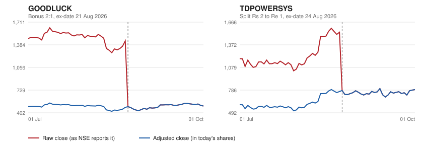

# adjusted

[](https://github.com/veer0608/adjusted/actions/workflows/tests.yml)

Split- and bonus-adjusted daily prices for NSE stocks, written in plain SQL on DuckDB.

## The problem

Exchange price files record what a share traded at that day. When a company splits its
shares or issues a bonus, the price per share falls overnight even though nobody lost any
money. Raw files report that as a crash.

From NSE's own bhavcopy, July to October 2026:

| Stock | Ex-date | Action | Raw move that day |
|---|---|---|---|
| GOODLUCK | 2026-08-21 | Bonus 2:1 | -65.90% |
| TDPOWERSYS | 2026-08-24 | Split Rs 2 to Re 1 | -49.17% |
| MWL | 2026-07-10 | Split Rs 10 to Re 1 | -90.10% |

NSE's `PrvsClsgPric` column is not adjusted on these days either, so any "top losers" list
built straight from the file, including the one in
[bhavcopy-pipeline](https://github.com/veer0608/bhavcopy-pipeline), shows these stocks as
the day's biggest fallers.

This repo joins the prices to NSE's corporate actions feeds and rewrites history in today's
share count, so a chart of GOODLUCK has no cliff on 21 August.



## Does it work?

The test that matters does not compare against my own expected numbers. It checks the market.
On an ex-date the exchange quotes in new shares from the first trade, so that day's **open**
should sit near the **adjusted** previous close. A wrong factor shows up as a big opening gap.

Across all 23 splits and bonuses inside the price window:

| | Opening gap on the ex-date |
|---|---|
| Raw prices | -24% to -90% |
| Adjusted prices | 19 of 23 within ±3%, 22 within ±7%, widest +10.5% (NARMADA, a volatile opening that closed near the adjusted level) |

`tests/test_validation_ex6.py` fails if any adjusted gap reaches 15%, or if adjusting ever makes
a gap wider.

## Every big drop, accounted for

30 days had a raw move of -30% or worse. All 30 are explained:

| Drops | Cause |
|---|---|
| 23 | Split, bonus or demerger on that day, matched from the feeds |
| 4 | `-RE` rights entitlements, short-lived instruments that lose value as the deadline nears |
| 1 | GENESYS, on its rights-issue ex-date (rights are not adjusted here) |
| 1 | HEG, a demerger hidden by a rename (below) |
| 1 | POLICYBZR on 2026-09-24, -36% on 11x normal volume: the only genuine crash in three months |

## Things the data taught

- **No single key follows a stock.** A split gives TDPOWERSYS a new ISIN but keeps the symbol.
  A rename turns HEG into HEGAM but keeps the ISIN, and NSE files HEG's 7 September demerger
  under the new name. This repo joins on symbol, which handles splits and misses renames.
  Handling both needs a symbol history table, which is not built yet.
- **A stock can change series.** NSE moved INDIAGLYCO from EQ to BE around its demerger.
  Partitioning by series cuts its history at exactly the day that matters.
- **ETF actions live in a different feed.** Six ETFs fell about 90% in a day (GOLDADD, PSUBANK
  and others). They were 10:1 unit splits, listed only in NSE's `mf` feed, not `equities`.
- **That feed lists every action twice.** Loaded as-is, a 10:1 split is applied twice and the
  factor becomes 100. `fetch_actions.py` drops the copies.
- **NSE's previous close is not adjusted either.** `PrvsClsgPric` on GOODLUCK's bonus day is
  the old 1439.40, so even the exchange's own change column shows -65.90%.
- **Demergers cannot be adjusted with a ratio.** NSE lists them with no ratio, and the price
  drop depends on what the spun-off company is worth. They are identified, not adjusted.

## Layout

```
data/prices.parquet           NSE EQ+BE daily prices, 2026-07-01 to 2026-10-01 (183,960 rows)
data/corporate_actions.csv    NSE corporate actions, stocks + ETFs, 2026-07-01 to 2026-10-09 (1,237 rows)
sql/01..06_*.sql              the work: one SELECT per file, each becomes a view
tests/test_ex1..6.py          checks for each query
tests/test_validation_ex6.py  checks the adjustment against ex-date opening prices
db.py                         builds the database from data/ and sql/
fetch_actions.py              refreshes corporate_actions.csv from NSE
snapshot_prices.py            refreshes prices.parquet from the bhavcopy-pipeline warehouse
make_chart.py                 draws docs/before_after.svg
```

| # | Query | SQL it exercises |
|---|---|---|
| 1 | `action_factors` | CASE, NULL from an unmatched CASE |
| 2 | `busy_symbols` | WHERE vs HAVING |
| 3 | `daily_moves` | LAG, PARTITION BY |
| 4 | `big_drops` | LEFT JOIN, where a right-table filter belongs |
| 5 | `adjusted_prices` | inequality join, product via EXP(SUM(LN())), NULL from an empty aggregate |
| 6 | `adjusted_movers` | RANK vs DENSE_RANK |

## Running it

PowerShell, from this folder:

```powershell
python -m venv .venv
.venv\Scripts\python -m pip install -r requirements.txt
.venv\Scripts\python -m pytest tests/test_ex1.py
.venv\Scripts\python db.py 1
```

`db.py N` builds everything up to query N and prints its first rows.

## Status

All six queries are written and all 43 tests pass. They were written by Claude at my request,
with a comment on every line explaining why it is there, and I worked through each one by
answering an interview-style question about it (why HAVING and not WHERE, why partition by
symbol, why a right-table filter belongs in ON, why the COALESCE).
